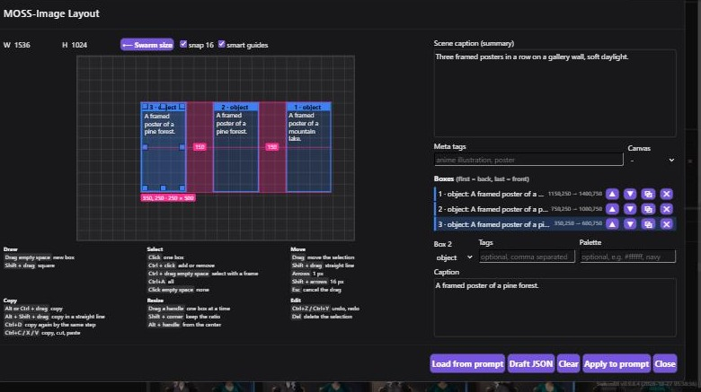

# SwarmUI MOSS Layout

A visual editor for MOSS-Image Layout prompts in the Generate tab of [SwarmUI](https://github.com/mcmonkeyprojects/SwarmUI).
Draw boxes on a canvas sized like your image, describe what goes in each one, and the editor writes the compiled layout prompt into the prompt box and sets the image size.

Boxes move, resize and copy like shapes in a vector or slide editor, with smart guides for alignment and equal spacing.



## Install

1. Clone this repository into SwarmUI's extensions folder:
   ```
   cd SwarmUI/src/Extensions
   git clone <this repository's URL> SwarmUI-MossLayout
   ```
2. Rebuild and restart SwarmUI: close it and start it with `launch-windows-dev.ps1` or `launch-linux-dev.sh` once. Regular launches also rebuild when the git hash changes.
3. A **MOSS Layout** button appears on the top edge of the prompt box in the Generate tab.

It needs nothing else: no extra models, packages or web connections. It only edits the prompt box, so use it with a MOSS-Image model that understands layout prompts.

## Controls

The same list stays on screen under the canvas.

| Action | How |
|---|---|
| New box | Drag on empty space (Shift: square) |
| Move | Drag a box |
| Resize | Drag one of the eight handles |
| Resize keeping the ratio | Shift + drag a corner |
| Resize from the center | Alt + drag a handle |
| Select several | Ctrl + click boxes, or in the box list |
| Select with a frame | Ctrl + drag on empty space (every box it touches) |
| Select all | Ctrl+A |
| Move several | Drag any selected box. They snap as one group |
| Scale several | Drag a handle of the frame around them (Shift: keep ratio, Alt: from the center) |
| Copy | Alt or Ctrl + drag a box, or a selected group |
| Move or copy in a straight line | Shift while dragging (axis follows the larger movement) |
| Copy again by the same step | Ctrl+D after a copy made by dragging, for a group too |
| Copy, cut, paste | Ctrl+C, Ctrl+X, Ctrl+V |
| Undo, redo | Ctrl+Z, Ctrl+Y or Ctrl+Shift+Z, or the buttons in the toolbar |
| Nudge | Arrows: 1 px, Shift + arrows: 16 px |
| Cancel the drag | Esc |
| Delete | Del |

Copy, paste, delete, nudge, undo and Esc all act on the whole selection. Editing the text works on one box at a time. Modifiers also work when pressed in the middle of a drag.

## Smart guides

While you drag, a box snaps to the things around it and the editor highlights why:

- **Alignment**: edges and centers line up with other boxes and with the center of the canvas. A thin line shows it.
- **Equal spacing**: the gap to a neighbour matches a gap between two other boxes, or the box sits halfway between two neighbours. Every matching range is filled and labeled in pixels.
- **Distance from the edge**: the box stands as far from a canvas edge as another box does from its nearest edge, including the opposite one, so you can mirror a box across the canvas.
- **Equal size**: when resizing, the width or height matches another box.

Boxes count as neighbours when they share a row or a column. Turn off **smart guides** in the toolbar if you want free movement. **snap 16** is the fallback grid for when no guide is in reach.

## Prompts and drafts

- **Apply to prompt** writes the compiled prompt (`abs_centralized`, `yxyx`) and sets the size in SwarmUI.
- **Load from prompt** reads a compiled prompt or a draft back. A compiled prompt holds no size of its own, so set the image size it was made for first. A draft carries its size.
- **Draft JSON** shows or takes the editable draft:

```json
{
  "width": 1536, "height": 1024, "bbox_coord_space": "abs", "bbox_format": "xyxy",
  "summary": { "caption": "The whole scene." },
  "items": [{ "label": "object", "caption": "What is in this box.", "bbox": [100, 200, 500, 700] }]
}
```

`bbox` is `[x1, y1, x2, y2]` in image pixels from the top left. `label` is `character`, `object` or `text`, and a `text` box also has a `text` field with the exact characters.

## Development

Everything is in `Assets/moss_layout.js` and `Assets/moss_layout.css`. SwarmUI keeps assets in memory, so restart it to see changes.

```
node --test tests/snap.test.js
python -m http.server 7886
```

The first command tests the snapping geometry. With the second running in this folder, `http://localhost:7886/tests/harness.html` opens the editor outside SwarmUI.

## License

[MIT](LICENSE)
