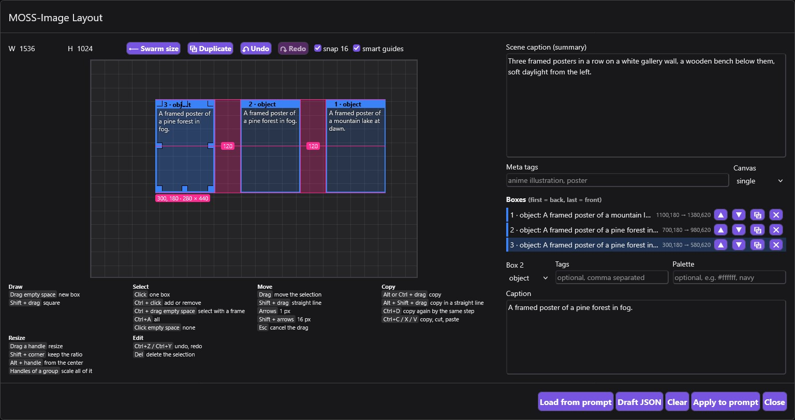
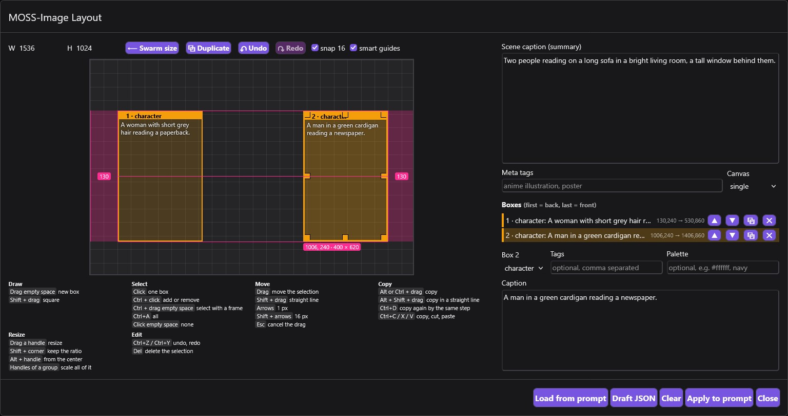
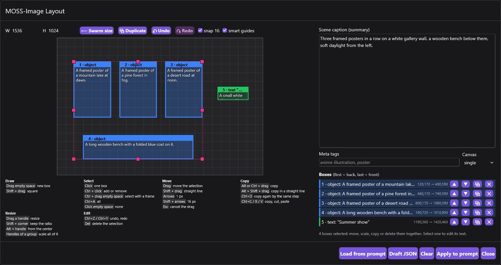

# SwarmUI MOSS Layout

A visual editor for MOSS-Image Layout prompts in [SwarmUI](https://github.com/mcmonkeyprojects/SwarmUI). Draw boxes on a canvas, describe what goes in each one, and **Apply** writes the layout prompt and sets the image size. Boxes move, scale and copy like shapes in a vector editor, and every shortcut stays listed under the canvas.

**Equal spacing.** Alt + Shift + drag copies a box in a straight line, and it snaps to the gap the other boxes already use.



**Distance from the edge.** A box snaps to the margin of another one, even across the canvas.



**Groups.** Select with Ctrl + click, a Ctrl + drag frame or Ctrl+A, then move, copy or scale everything together.



## Install

```
cd SwarmUI/src/Extensions
git clone https://github.com/Wanlinj1/SwarmUI-MossLayout
```

Then rebuild and restart SwarmUI with `launch-windows-dev.ps1` or `launch-linux-dev.sh`. The **MOSS Layout** button appears on the prompt box in the Generate tab.

## License

[MIT](LICENSE)
